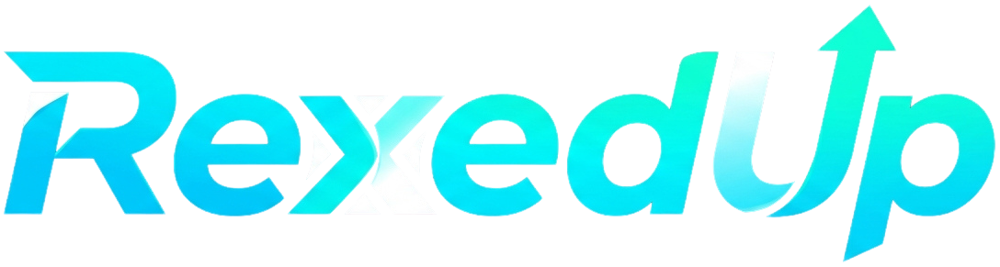
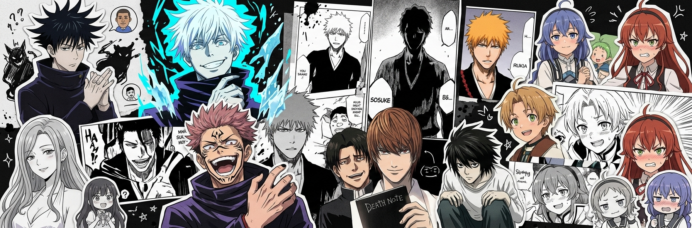
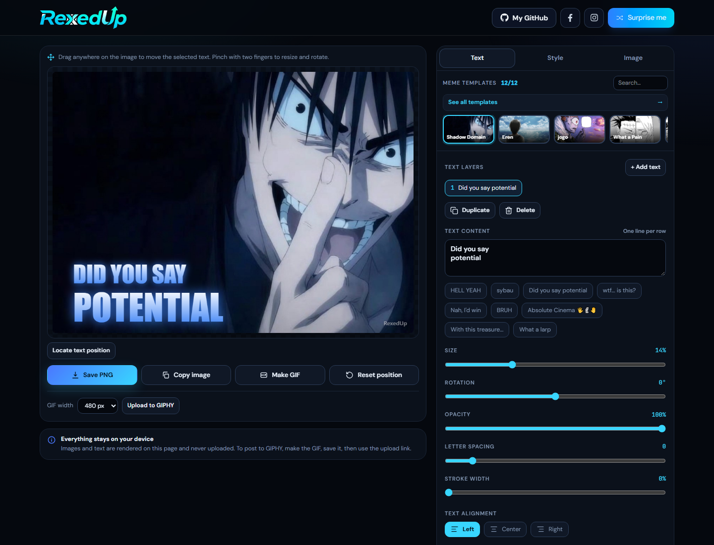
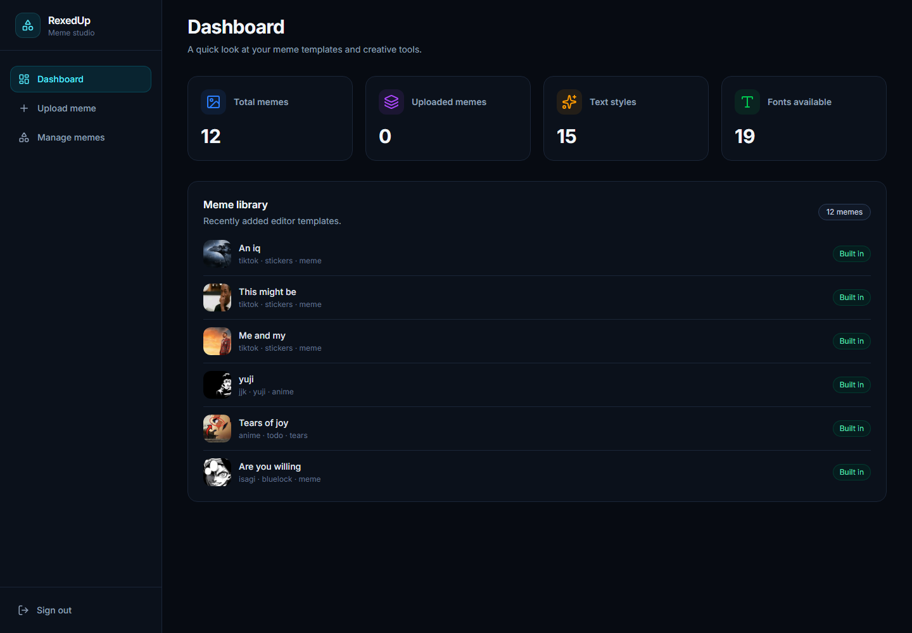
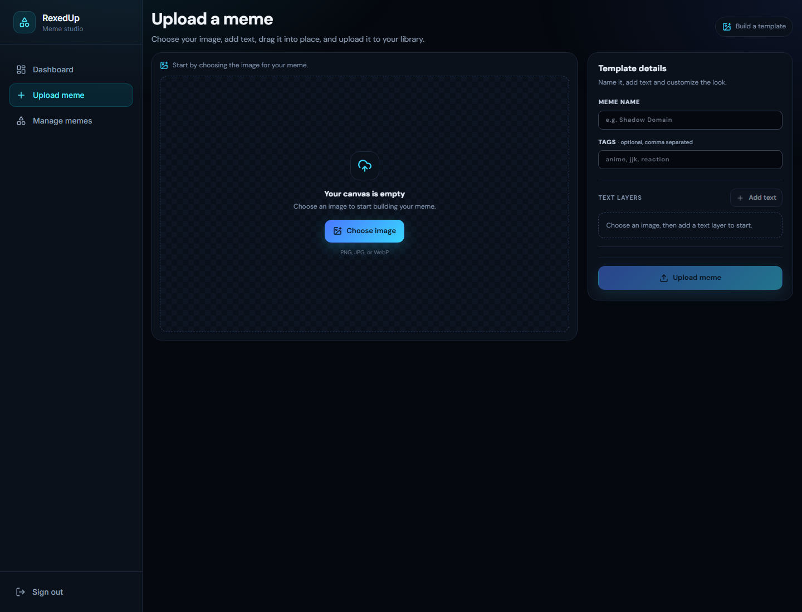
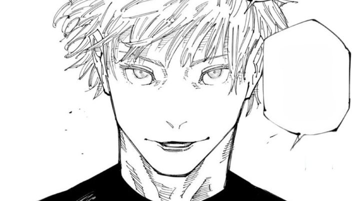
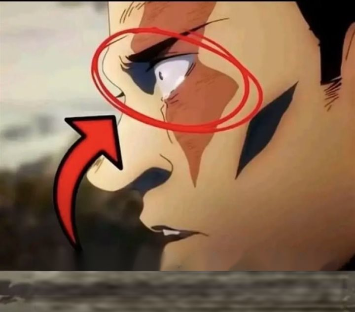
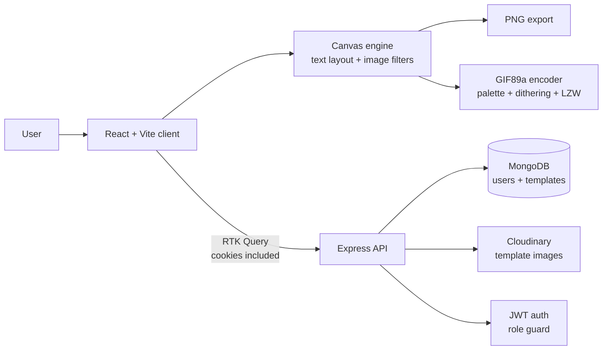

<div align="center">

<a href="https://rexedup.vercel.app/">
  
</a>

### Make memes. Break the internet. In seconds.

**RexedUp** is a free, open-source meme studio that runs in your browser.  
Pick a template, add draggable text, apply studio-grade effects, and export a crisp PNG or GIF — no sign-up, no uploads, no nonsense.

<p>
  <a href="https://rexedup.vercel.app/">
    
  </a>
  <a href="https://github.com/Munna-Scriptz/RexedUp/stargazers">
    
  </a>
  <a href="https://github.com/Munna-Scriptz/RexedUp/network/members">
    
  </a>
  <a href="https://github.com/Munna-Scriptz/RexedUp/issues">
    
  </a>
  <a href="LICENSE">
    
  </a>
  <a href="https://github.com/Munna-Scriptz/RexedUp/pulls">
    
  </a>
</p>

<p>
  
  
  
  
  
  
  
</p>

<a href="https://rexedup.vercel.app/">
  
</a>

*A few of the anime and manga inspired templates that ship with RexedUp.*

</div>

---

## Table of Contents

- [Why RexedUp?](#why-rexedup)
- [Screenshots](#screenshots)
- [Features](#features)
- [Tech Stack](#tech-stack)
- [Architecture](#architecture)
- [Project Structure](#project-structure)
- [Quick Start](#quick-start)
- [Environment Variables](#environment-variables)
- [Admin Setup](#admin-setup)
- [API Reference](#api-reference)
- [Adding Your Own Templates](#adding-your-own-templates)
- [Deployment](#deployment)
- [Roadmap](#roadmap)
- [Contributing](#contributing)
- [Security](#security)
- [License](#license)
- [Connect](#connect)

---

## Why RexedUp?

Most meme generators make you create an account, upload your image to someone else's server, then slap a giant watermark on the result. RexedUp takes the opposite approach.

| | |
| :--- | :--- |
| ⚡ **Instant** | The editor loads with a real template already on the canvas. Type, drag, export. No onboarding flow. |
| 🔒 **Local-first** | Your image is decoded, edited and rendered entirely in the browser with the Canvas API. The editor never uploads it. |
| 🎨 **Actually customizable** | 19 fonts, 15 text effects, multiple layers, per-layer colors, strokes, glow, rotation, opacity and spacing. |
| 📱 **Touch-ready** | Drag to move, pinch to resize and rotate, double-tap to edit. Built for phones as much as desktops. |
| 🧩 **Extensible** | Templates are plain JavaScript objects. Add your own image and coordinates in one file. |
| 🛠️ **Full admin studio** | An admin-only dashboard for uploading, editing and deleting templates backed by MongoDB and Cloudinary. |

> **Privacy note:** meme editing and exports happen locally. The only images that leave your device are templates you explicitly upload through the admin studio. The site uses Vercel Analytics for anonymous page-level traffic insights.

---

## Screenshots

### The editor

<a href="https://rexedup.vercel.app/">
  
</a>

*Pick a template, edit the text, move it directly on the image, then save a PNG or GIF.*

<br />

### The admin studio

<p align="center">
  
  
</p>

*Dashboard insights and an in-browser template builder — no separate design tool required.*

<br />

### Template library preview

<p align="center">
  
  
  
  
</p>

<p align="center"><em>Every built-in template is fully editable — text, font, effect, colors and position.</em></p>

---

## Features

### 🖌️ The meme editor

- **12 built-in templates** — anime, manga, reaction and TikTok-style layouts, ready to edit.
- **Template search** — filter by name or tag. The horizontal strip also responds to mouse-wheel scrolling.
- **“Surprise me”** — instantly rolls a random template, font, effect, color and caption.
- **Multiple text layers** — add, duplicate, delete and switch between as many layers as you need.
- **Direct manipulation** — drag text anywhere on the canvas with pointer events.
- **Two-finger gestures** — pinch to resize and rotate layers on touch devices.
- **Double-tap to edit** — jump straight into the text field on mobile.
- **Smart positioning** — center-snap guides, top/middle/bottom placement and one-click reset.
- **Position helper** — click the canvas to capture exact `textPositions` coordinates for new templates.
- **Auto-fit** — text shrinks to stay inside the image instead of overflowing.
- **Live preview** — every change redraws through a throttled `requestAnimationFrame` loop, so what you see is exactly what exports.

### 🔤 Typography & effects

- **19 hand-picked fonts** including Anton, Bangers, Bebas Neue, Oswald, Permanent Marker, Press Start 2P, Creepster and Impact.
- **15 text effects**: Plain, Manga, Comic, Classic, Emboss, Fire, Gradient, Glow, Neon, Glitch, Impact Meme, 3D Text, Retro Arcade, Sticker and Outline.
- **Full color control** for text, glow and stroke, plus nine ready-made glow swatches.
- **Fine-tuning sliders** for size, rotation, opacity, letter spacing, stroke width, stroke opacity and glow intensity.
- **Layout controls** for left / center / right alignment, all caps, shrink-lines-above and auto-fit.
- **One-tap phrases** for fast meme captions — or type your own multi-line text.

### 🖼️ Image lab

- **Bring your own image** via file picker, drag-and-drop, or clipboard paste (`Ctrl` / `Cmd` + `V`).
- **Non-destructive adjustments**: brightness, contrast, saturation, blur, darken and vignette.
- **Instant reset** for all picture effects.
- **Source-aware sizing** — large images are scaled to a max of 1280 px for smooth editing while preserving aspect ratio.

### 📦 Export

- **Save PNG** at full canvas resolution.
- **Copy image** straight to the clipboard.
- **Make GIF** using a custom GIF89a encoder at 320, 480 or 640 px width. Single-frame GIF export ships today; multi-frame animation is on the roadmap.
- **Export preview sheet** with file metadata, save, copy and GIPHY upload shortcut.
- **Progress feedback** while GIF frames are encoded.
- **Configurable watermark** — the subtle “RexedUp” credit lives in `client/src/data/memeTemplates.js`.

### 🛠️ Admin studio

- **Cookie-based JWT authentication** with an admin-only route guard.
- **Dashboard** with total templates, uploaded templates, text styles and font counts.
- **Template uploader** with the same canvas engine as the public editor.
- **Cloudinary integration** for durable template image hosting.
- **Template manager** with search, newest/oldest sorting, inline editing of names and tags, and permanent deletion.
- **Built-in templates stay read-only** — uploaded templates are the only ones that can be edited or removed.

### 💻 Developer experience

- **Vite 8** dev server with instant HMR.
- **RTK Query** for cached API calls with tag invalidation.
- **Reusable meme engine** split into pure Canvas functions (`canvasEngine.js`) and a dependency-free GIF encoder (`gifEncoder.js`).
- **Tailwind CSS 4** design tokens for the blue → cyan RexedUp theme.
- **Accessible controls** with ARIA roles, labels, keyboard tab navigation and live regions.
- **Responsive layout** that collapses the editor into a mobile-friendly single column.

---

## Tech Stack

| Layer | Technology | What it powers |
| :--- | :--- | :--- |
| **UI** | React 19 | Component architecture |
| **Build** | Vite 8 | Dev server and production bundle |
| **Styling** | Tailwind CSS 4 + custom CSS | Theme, editor layout, animations |
| **State / data** | Redux Toolkit + RTK Query | API cache, auth mutations, template tags |
| **Routing** | React Router 8 | Public editor and admin routes |
| **Icons** | Lucide React + React Icons | Editor controls and social links |
| **Rendering** | Canvas 2D API | Text layout, filters, PNG export |
| **GIF** | Custom GIF89a encoder | Palette quantization, Bayer dithering, LZW compression |
| **Server** | Node.js + Express 5 | REST API |
| **Database** | MongoDB + Mongoose 9 | Users and uploaded templates |
| **Auth** | JWT + bcrypt + HttpOnly cookies | Admin sessions and password hashing |
| **Media** | Cloudinary | Template image storage |
| **Deploy** | Vercel | Static frontend + serverless API |

---

## Architecture



**Key design decisions**

- **The editor is backend-independent.** All rendering, filters, PNG encoding and GIF encoding happen on the client. If the API is unavailable, the built-in templates still work.
- **The same engine powers admin uploads.** `canvasEngine.js` is shared between `Home.jsx` and `AdminUpload.jsx`, so template previews match the public editor exactly.
- **Templates are data, not components.** Each template describes an image, default text, a look, and normalized text positions. That makes the library trivial to extend.
- **Mutable engine state is kept in a ref.** React only re-renders controls; the canvas redraws through a `requestAnimationFrame` loop with a dirty flag to avoid redundant frames.

---

## Project Structure

```text
RexedUp/
├── client/
│   ├── public/                  # Logo, favicon, OG image, robots, sitemap
│   ├── src/
│   │   ├── api/                 # RTK Query base API + endpoints
│   │   ├── assets/              # Built-in meme template images
│   │   ├── components/          # Navbar, cards, meme controls, loaders
│   │   ├── data/
│   │   │   └── memeTemplates.js # Fonts, effects, phrases and templates
│   │   ├── layout/              # Public + admin layouts
│   │   ├── lib/meme/
│   │   │   ├── canvasEngine.js  # Canvas text rendering engine
│   │   │   └── gifEncoder.js    # Zero-dependency GIF89a encoder
│   │   ├── pages/               # Home + admin pages
│   │   ├── styles/              # Meme editor styles
│   │   ├── App.jsx
│   │   └── main.jsx
│   ├── index.html               # SEO, Open Graph, JSON-LD
│   ├── vite.config.js
│   └── vercel.json              # SPA rewrites
├── server/
│   ├── controllers/             # Auth + meme template logic
│   ├── db/                      # Mongoose connection
│   ├── middlewares/             # Auth, role check, errors
│   ├── models/                  # User + template schemas
│   ├── routes/                  # /auth and /memes
│   ├── services/                # JWT, Cloudinary
│   ├── utils/                   # AppError, AsyncHandler, responses
│   ├── server.js
│   └── vercel.json              # Serverless entry
├── docs/
│   ├── screenshots/             # README screenshots
│   └── showcase/                # Optimized template previews
├── LICENSE
└── README.md
```

---

## Quick Start

### Prerequisites

- **Node.js 20.19+** (22 LTS recommended)
- **npm 10+**
- **MongoDB** — required for the API and admin studio; not needed for the standalone editor
- **Cloudinary account** — required for admin template uploads

### 1. Clone the repository

```bash
git clone https://github.com/Munna-Scriptz/RexedUp.git
cd RexedUp
```

### 2. Start the client

```bash
cd client
npm install
```

Create `client/.env` from the example:

```bash
cp .env.example .env
```

The default points at the local API:

```env
VITE_API_URL=http://localhost:8000
```

```bash
npm run dev
```

Open **http://localhost:5173**.

> The editor works with zero backend setup. Built-in templates render locally; only the “all templates” database list will show an error until the API is running.

### 3. Start the server

In a second terminal:

```bash
cd server
npm install
```

Create `server/.env` from the example:

```bash
cp .env.example .env
```

Then fill in your own values:

```env
DB_STRING=mongodb://127.0.0.1:27017/rexedup
JWT_SEC=replace-with-a-long-random-secret
CLIENT_URL=http://localhost:5173

CLOUD_NAME=your-cloudinary-cloud-name
CLOUD_API_KEY=your-cloudinary-api-key
CLOUD_API_SEC=your-cloudinary-api-secret

NODE_ENV=development
```

```bash
npm start
```

The API runs at **http://localhost:8000**.

### Available scripts

| Location | Command | Description |
| :--- | :--- | :--- |
| `client` | `npm run dev` | Start Vite with HMR |
| `client` | `npm run build` | Production build to `dist/` |
| `client` | `npm run preview` | Preview the production build |
| `client` | `npm run lint` | Run Oxlint |
| `server` | `npm start` | Start Express with `node --watch` |

---

## Environment Variables

### Client (`client/.env`)

> Copy `client/.env.example` to `client/.env` and adjust as needed.

| Variable | Required | Description |
| :--- | :---: | :--- |
| `VITE_API_URL` | ✅ | Base URL of the Express API, without a trailing slash. Example: `http://localhost:8000`. |

### Server (`server/.env`)

> Copy `server/.env.example` to `server/.env` and fill in real credentials.

| Variable | Required | Description |
| :--- | :---: | :--- |
| `DB_STRING` | ✅ | MongoDB connection string. |
| `JWT_SEC` | ✅ | Secret used to sign and verify JWTs. Use a long random value. |
| `CLIENT_URL` | ✅ | Exact frontend origin allowed by CORS and cookies. |
| `CLOUD_NAME` | ✅ | Cloudinary cloud name. |
| `CLOUD_API_KEY` | ✅ | Cloudinary API key. |
| `CLOUD_API_SEC` | ✅ | Cloudinary API secret. |
| `NODE_ENV` | Optional | `development` locally; `production` on Vercel. |

> Never commit `.env` files. Add them to `.gitignore` and use your host's environment variable dashboard in production.

---

## Admin Setup

RexedUp intentionally has **no public sign-up page**. To create an admin:

1. Create a user through the API:

```bash
curl -X POST http://localhost:8000/auth/signup \
  -H "Content-Type: application/json" \
  -d "{\"email\":\"you@example.com\",\"password\":\"a-strong-password\"}"
```

2. Promote the account in MongoDB:

```js
db.users.updateOne(
  { email: "you@example.com" },
  { $set: { role: "admin" } }
)
```

3. Sign in at **http://localhost:5173/admin/login**.

4. From the studio you can:
   - view dashboard statistics,
   - upload a new template with custom text layers,
   - search, edit and delete uploaded templates.

---

## API Reference

Base URL: `http://localhost:8000`

All JSON responses follow this shape:

```json
{
  "success": true,
  "statusCode": 200,
  "message": "Meme templates fetched",
  "data": []
}
```

### Auth

| Method | Endpoint | Access | Description |
| :---: | :--- | :--- | :--- |
| `POST` | `/auth/signup` | Public | Create an account with email + password. |
| `POST` | `/auth/signin` | Public | Sign in and receive an HttpOnly `X-AS-TOKEN` cookie. |
| `POST` | `/auth/logout` | Public | Clear auth cookies. |
| `GET` | `/auth/profile` | Authenticated | Return the current user and auth state. |

### Meme templates

| Method | Endpoint | Access | Description |
| :---: | :--- | :--- | :--- |
| `GET` | `/memes/templates` | Public | List uploaded templates, newest first. |
| `POST` | `/memes/templates` | Admin* | Upload a template image and its text metadata. |
| `PATCH` | `/memes/templates/:id` | Admin* | Update a template name and/or tags. |
| `DELETE` | `/memes/templates/:id` | Admin* | Delete a template and its Cloudinary image. |

\* **Intended access.** The `adminOnly` array (`authMiddleware` + `roleCheckMiddleware("admin")`) is defined in `server/routes/memes.js` but must be attached to the write routes before exposing your own instance publicly. See [Security](#security).

### Example: upload a template

```json
{
  "name": "Shadow Domain",
  "tags": ["megumi", "jjk", "shadow", "reaction"],
  "imageDataUrl": "data:image/jpeg;base64,...",
  "text": "Did you say\npotential",
  "texts": [
    {
      "text": "Did you say\npotential",
      "font": "Anton",
      "style": "gradient",
      "color": "#ffffff",
      "glow": "#3b82f6",
      "size": 14
    }
  ],
  "look": {
    "style": "gradient",
    "glow": "#3b82f6",
    "color": "#ffffff",
    "font": "Anton"
  },
  "size": 14,
  "textPositions": [{ "x": 0.0572, "y": 0.8534 }],
  "allCaps": true,
  "shrinkAbove": true,
  "textAlignment": "left"
}
```

---

## Adding Your Own Templates

Templates live in [`client/src/data/memeTemplates.js`](client/src/data/memeTemplates.js). Add an image import and a new object to the `TEMPLATES` array:

```js
import myTemplate from "../assets/memeBg/my-template.png";

export const TEMPLATES = [
  // ...existing templates
  {
    id: "my-template",
    name: "My Template",
    tags: ["anime", "reaction", "custom"],
    text: "TOP TEXT\nBOTTOM TEXT",
    size: 14,
    look: {
      style: "impact",
      glow: "#06b6d4",
      color: "#ffffff",
      font: "Anton",
    },
    allCaps: true,
    shrinkAbove: true,
    textAlignment: "center",
    image: myTemplate,
    textPositions: [
      { x: 0.5, y: 0.15 },
      { x: 0.5, y: 0.85 },
    ],
  },
];
```

**Positioning tip:** open the editor, click **“Locate text position”**, then click the canvas. RexedUp logs and copies the exact `{ x, y }` values for you.

**Multiple layers with different styling:** use the `texts` array instead of a single `text` string. Each entry can override `text`, `size`, `color`, `x`, `y` and other layer properties.

**Watermark:** set `WATERMARK_ENABLED = false` in the same file to disable the “RexedUp” credit.

---

## Deployment

Both halves are configured for **Vercel**.

### Frontend

1. Import the repository into Vercel.
2. Set **Root Directory** to `client`.
3. Framework preset: **Vite**.
4. Build command: `npm run build` — output directory: `dist`.
5. Add the environment variable:
   ```env
   VITE_API_URL=https://your-api.vercel.app
   ```
6. Deploy. `client/vercel.json` already rewrites all routes to `index.html` for React Router.

### Backend

1. Create a second Vercel project from the same repository.
2. Set **Root Directory** to `server`.
3. Add `DB_STRING`, `JWT_SEC`, `CLIENT_URL`, `CLOUD_NAME`, `CLOUD_API_KEY`, `CLOUD_API_SEC` and `NODE_ENV=production`.
4. Set `CLIENT_URL` to the exact production frontend origin, for example `https://rexedup.vercel.app`.
5. Deploy. `server/vercel.json` routes requests to the Express app.

> In production the auth cookie is `Secure` + `SameSite=None`, so both apps must be served over HTTPS. Vercel provides this by default.

### Database & media

- Create a MongoDB Atlas cluster and allow your Vercel deployment to connect.
- Create a Cloudinary account and copy the cloud name, API key and API secret into the server environment.
- Uploaded template images are stored in the `meme-templates` folder.

---

## Roadmap

- [x] Browser-based meme editor with draggable text layers
- [x] 19 fonts and 15 canvas text effects
- [x] PNG, clipboard and GIF export
- [x] Admin dashboard, uploader and template manager
- [x] MongoDB + Cloudinary persistence
- [ ] **Security:** attach `adminOnly` to template write routes by default
- [ ] Multi-frame animated GIF editor with timeline controls
- [ ] Automated tests for the canvas engine and GIF encoder
- [ ] Refresh-token rotation and session management
- [ ] Keyboard shortcuts for power users
- [ ] Template categories, favorites and public gallery
- [ ] PWA manifest branding and offline shell
- [ ] Internationalization (i18n)
- [ ] Accessibility audit and reduced-motion polish

Have an idea? [Open a feature request](https://github.com/Munna-Scriptz/RexedUp/issues/new).

---

## Contributing

Contributions are what make open source fun. Whether it is a new template, a bug fix, or a documentation improvement — you are welcome here.

```bash
# 1. Fork the repo, then clone your fork
git clone https://github.com/<your-username>/RexedUp.git
cd RexedUp

# 2. Create a branch
git checkout -b feat/my-awesome-feature

# 3. Make your changes, then verify
cd client
npm run lint
npm run build

# 4. Commit and push
git commit -m "feat: add my awesome feature"
git push origin feat/my-awesome-feature
```

Then open a pull request against `main`.

### Contribution guidelines

- Match the existing code style and file organization.
- Keep pull requests focused — one feature or fix per PR.
- Include screenshots or a short clip for UI changes.
- Do not commit `.env` files, API keys, or build output.
- New dependencies should be justified; the editor is intentionally lightweight.
- Be respectful and constructive in reviews.

### Good first issues

- Add a new built-in meme template with text positions.
- Improve mobile layout or touch interactions.
- Add a new text effect to `canvasEngine.js`.
- Improve error messages and empty states.
- Write tests for `gifEncoder.js` or `canvasEngine.js`.
- Fix typos or improve this README.

Look for the [`good first issue`](https://github.com/Munna-Scriptz/RexedUp/labels/good%20first%20issue) label.

---

## Security

RexedUp is a learning-friendly open-source project, but please follow these practices if you deploy it:

- **Protect write routes.** `server/routes/memes.js` defines an `adminOnly` middleware array but does not yet attach it to the upload, update and delete routes. Add it before going public.
- **Use strong secrets.** Generate `JWT_SEC` with at least 32 random bytes and rotate it if leaked.
- **Never commit credentials.** Keep `.env` files and Cloudinary keys out of Git.
- **Validate uploads.** The API already restricts template images to PNG/JPEG/WebP and enforces a size cap; keep those checks when extending the endpoint.
- **Use HTTPS in production.** Secure cookies require it.
- **Report vulnerabilities privately.** Please use [GitHub Security Advisories](https://github.com/Munna-Scriptz/RexedUp/security/advisories/new) or contact the maintainer instead of opening a public exploit issue.

---

## License

Released under the [MIT License](LICENSE).

You are free to use, modify, distribute and build on RexedUp — attribution is appreciated but not required.

### Artwork disclaimer

The built-in templates include anime and manga artwork used for parody and fan-content purposes. All characters and original artwork belong to their respective copyright holders. If you plan to use this project commercially, replace the bundled artwork with assets you have the rights to use.

---

## Connect

<div align="center">

**Built with too much caffeine and a questionable sense of humor by [Munna-Scriptz](https://github.com/Munna-Scriptz).**

<p>
  <a href="https://rexedup.vercel.app/">
    
  </a>
  <a href="https://github.com/Munna-Scriptz">
    
  </a>
  <a href="https://www.instagram.com/rexofr">
    
  </a>
  <a href="https://www.facebook.com/rexonfr">
    
  </a>
</p>

### ⭐ If RexedUp made you laugh, give it a star.

It helps more people find the project — and it makes the next late-night commit worth it.

[](https://star-history.com/#Munna-Scriptz/RexedUp&Date)

</div>
